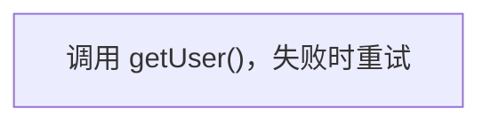

# Mermaid Plus

在桌面 Obsidian 中渲染和编辑 Mermaid 流程图。当前阶段：**插件自带渲染样式 + 原位可视化编辑（第一步）**——点选改字、增删节点和连线，自动写回笔记；尚未实现拖拽节点。

## 渲染样式

插件接管笔记中的 `mermaid` 代码块：流程图（`flowchart` / `graph`）用插件打包的 Mermaid 12 渲染，默认采用 Mermaid 官方默认主题（与 mermaid.live 相同）加紧凑间距，连线为直角走线（只有水平和垂直线，交叉处画半圆跳线）；时序图等其他类型仍交给 Obsidian 自带的 Mermaid。阅读视图、实时预览和编辑页使用同一个渲染器，外观完全一致。

在“设置 → Mermaid Plus”中可调：配色主题（跟随明暗 / 默认 / 中性 / 森林 / 暗色 / 基础）、紧凑程度（紧凑 / 适中 / 宽松，宽松即 Mermaid 默认值）、字体、字号、连线（直角走线 / 平滑曲线）、连线交叉处（跳线 / 断开 / 直接交叉）。直角走线使用 Mermaid 自带的 ELK 排版，其间距由 Mermaid 固定，紧凑程度此时只影响节点内边距；平滑曲线即 Mermaid 默认的 dagre 排版。

Mermaid 在第一次真正画流程图时才初始化，不拖慢 Obsidian 启动。修改后已打开的图会立即重画。

Obsidian 自带 mermaid 渲染，通常不允许插件再注册同名代码块处理器。此时插件自动改用兜底方式：阅读视图在 Obsidian 画图前后把流程图换成插件画的图；实时预览隐藏 Obsidian 的原图，在同一位置显示插件画的图。

注意：样式只在装了本插件的 Obsidian 中生效；手机端未装插件、发布站点或其他编辑器里仍按各自的 Mermaid 默认样式显示。

## 先体验注释样式

```sh
npm ci
npm run demo
```

打开 http://127.0.0.1:4173 。同一份源码会显示为普通 Mermaid 与注释增强版。选节点、输入文字片段、选择样式并点击“添加样式”，观察源码只有对应注释发生变化。可复制草稿，或修改源码后点击“刷新预览”。

演示服务仅监听本机。所有依赖本地打包，不需要远程图表服务。该演示不连接、读取或修改个人 Obsidian 知识库。

测试文档在 [examples/annotation-styles.md](examples/annotation-styles.md)。

对照截图和本轮实测结果见 [验证记录](docs/verification.md)。

## 自动整理节点与连线

演示页点击“多分支与回路示例”，再点击“自动整理”。也可以直接粘贴流程图源码。

- 自动比较横排和竖排的可读尺寸，也可选择跟随源码、自上而下或从左到右。
- 提供紧凑、适中、宽松三种间距；长节点文字自动换行。
- 连线采用避开节点的直角走线，可切换圆角或直角拐弯；连线文字参与布局。
- 分支和汇合使用独立连接点，减少箭头重叠；保留回路和重复连线。
- “展开增强图”提供完整宽度；大图最多缩小到 80%，可滚动查看。
- 计算在独立 Worker（后台计算线程）运行，切换或关闭时取消，超过 8 秒停止。

布局设置仅影响本次预览，不改写源码、样式注释或笔记，也尚未保存为布局注释。算法尽量减少交叉，不保证任意图完全无交叉。详细验证见 [自动排版记录](docs/auto-layout-verification.md)。

## 原位可视化编辑

鼠标移到流程图上，右上角出现“源码 / 编辑”工具条。“源码”在实时预览中把光标移进代码块、由 Obsidian 显示源码，在阅读视图中在图下方展开只读源码（再点收起）；它取代了 Obsidian 代码块自带的 `</>` 按钮。点击“编辑”进入可视化编辑；也可以把光标放进代码块，执行命令“Mermaid Plus: 编辑光标所在的 Mermaid 流程图”（默认无快捷键，可在设置里绑定）。

编辑时的图与阅读视图由同一个渲染器画出，完全一致；交互参照 Obsidian 白板（Canvas）：

- 单击选中节点或连线，出现选中框和悬浮工具条（改文字 / 接一个节点 / 删除）。
- 选中节点四边有连接点：拖到另一个节点上松开即连线；拖到空白处松开会新建节点并连过去。
- 双击节点或连线改文字（也可按 Enter），Shift+Enter 换行（写成 `<br/>`）；双击空白处新建独立节点。
- “新增节点”/“接一个节点”：从选中节点连出新节点，并放进同一个子图。
- Delete 删除选中项；删除节点会同时删掉它的连线和样式注释。
- 撤销/重做：实时预览中进入编辑器自身的历史，退出编辑后 Cmd+Z 仍可撤销；阅读视图由插件保存本次编辑的历史。
- Esc 先取消选择，再退出编辑。
- 新节点的位置由 Mermaid 自动排布，暂不能拖动节点到指定位置。

写回只改动涉及的行，其余缩进、注释、顺序和行尾不变。写入前核对代码块内容；如果它已在别处被修改，就拒绝写入并提示，不会覆盖。改字后仍能找到的样式片段会保留。

演示页点击“可视化编辑”（或打开 `/#editor`）可在浏览器中体验，修改只写入页面内的模拟笔记。

## 注释协议（实验版 v1）



| 字段 | 含义 |
| --- | --- |
| `version` | 注释协议版本，目前为 1 |
| `node` | Mermaid 节点编号 |
| `label` | 应用样式时的完整原始标签，用于防止文字变化后错绑 |
| `styles` | 文字片段及样式列表 |
| `text` | 要应用样式的原文片段 |
| `type` | `code` 内联代码、`bold` 加粗、`italic` 斜体、`highlight` 高亮 |
| `occurrence` | 可选，从 0 开始的出现序号；重复文字未指定时跳过 |

注释让样式随源码迁移。普通 Mermaid 忽略注释，文字与连线仍可显示；外部工具不会自动获得额外样式。需要外观一致时，后续可以增加图片导出。

本次实验用注释验证全部四种样式；最终产品仍计划优先保留 Mermaid 原生粗体、斜体语法。

安全和保真行为：

- 原始标签与 `label` 不一致时跳过样式；不猜测新位置。
- 损坏 JSON、未知版本、非法样式、同节点重复注释均提示并跳过。
- 同一片段可叠加样式。标签作为文字节点渲染，不执行 HTML。
- 添加样式仅修改对应注释；保留其他源码及行尾。
- 支持 `flowchart` / `graph` 流程图：子图、常见节点形状（方、圆角、圆、体育场、菱形、六边形等，增强图中近似为方/圆角/菱形）、实线/虚线/粗线及 `-- 文字 -->` 写法、`:::类名`、行尾分号、前置配置。`classDef`、`style`、`linkStyle`、`click` 等语句原样保留但不参与增强显示。暂不支持 `A & B` 连写、`@{ }` 形状写法、把子图当连线端点；遇到时提示具体哪一行，保留原生预览与源码。
- 增强侧使用 ELK（自动计算节点、连线与标签位置的布局引擎），按带样式的文字尺寸布局；布局与原生 Mermaid 不保证相同。

## Obsidian 构建产物

```sh
npm run build
```

产物为 `dist/main.js`、`dist/manifest.json`、`dist/styles.css`（`dist/mermaid-plus-0.1.0.zip` 为三者打包）。复制到知识库的 `.obsidian/plugins/mermaid-plus/` 并启用即可。`main.js` 约 5 MB，因为打包了完整的 Mermaid。目前只在浏览器演示页中测试过，尚未在真实 Obsidian 中验证。

注释样式实验（文字片段加粗、高亮等）目前只在演示页中提供，插件里已不再包含该命令。

开发过程中未向个人知识库安装插件，尚未做 Obsidian 应用内验收。编辑器与写回逻辑已通过单元测试和浏览器测试，Obsidian 集成部分仅做构建与公开接口类型检查；建议先在单独的测试知识库中试用。

## 开发验证

```sh
npm run check
npm run test:browser
```

浏览器测试使用本机 Google Chrome 的独立无头进程，不使用用户浏览器配置。也可调整 `playwright.config.ts` 使用已安装的 Playwright Chromium。

`npm run dev` 监听插件 TypeScript 修改；修改清单或样式后需重启构建。`npm run demo` 启动一次构建的演示服务，改代码后重启。

## 后续已确定方向

- 仅桌面；优先已有流程图。
- 阅读视图和实时预览均可原位进入编辑状态。
- 点选改字、增删节点连线（已完成）；下一步拖拽布局，位置存 `%% mermaid-plus` 注释。
- 保护未知语法，尽量只改对应源码。
- 自动保存、按操作撤销/重做；写回冲突时停止覆盖（已完成）。
- 测试材料留在项目仓库；按阶段提交并推送私有 GitHub。

## 调研参考

- [MermaidMaker](https://github.com/Akitaroh/obsidian-mermaid-maker)：正文内画布与注释坐标。
- [Mermaid Flow](https://github.com/THANSHEER/obsidian-mermaid-flow)：流程图编辑与源码保留。
- [Mehrmaid](https://github.com/huterguier/obsidian-mehrmaid)：节点内 Markdown 渲染。

当前实现未复制这些插件的源码。运行时依赖 [elkjs 0.12.1](https://github.com/kieler/elkjs/tree/v0.12.1)，未修改其源码；上游许可随构建产物一并提供。
