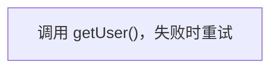

# Mermaid Plus

在桌面 Obsidian 中编辑已有 Mermaid 流程图。当前阶段是**注释样式验证原型**，尚未实现正文内拖拽与笔记自动保存。

## 先体验注释样式

```sh
npm ci
npm run demo
```

打开 http://127.0.0.1:4173 。同一份源码会显示为普通 Mermaid 与注释增强版。选节点、输入文字片段、选择样式并点击“添加样式”，观察源码只有对应注释发生变化。可复制草稿，或修改源码后点击“刷新预览”。

演示服务仅监听本机。所有依赖本地打包，不需要远程图表服务。该演示不连接、读取或修改个人 Obsidian 知识库。

测试文档在 [examples/annotation-styles.md](examples/annotation-styles.md)。

对照截图和本轮实测结果见 [验证记录](docs/verification.md)。

## 注释协议（实验版 v1）



| 字段 | 含义 |
| --- | --- |
| `version` | 注释协议版本，目前为 1 |
| `node` | Mermaid 节点编号 |
| `label` | 应用样式时的完整原始标签，用于防止文字变化后错绑 |
| `styles` | 文字片段及样式列表 |
| `text` | 要应用样式的原文片段 |
| `type` | `code` 内联代码、`bold` 加粗、`italic` 斜体、`highlight` 高亮 |
| `occurrence` | 可选，从 0 开始的出现序号；重复文字未指定时跳过 |

注释让样式随源码迁移。普通 Mermaid 忽略注释，文字与连线仍可显示；外部工具不会自动获得额外样式。需要外观一致时，后续可以增加图片导出。

本次实验用注释验证全部四种样式；最终产品仍计划优先保留 Mermaid 原生粗体、斜体语法。

安全和保真行为：

- 原始标签与 `label` 不一致时跳过样式；不猜测新位置。
- 损坏 JSON、未知版本、非法样式、同节点重复注释均提示并跳过。
- 同一片段可叠加样式。标签作为文字节点渲染，不执行 HTML。
- 添加样式仅修改对应注释；保留其他源码及行尾。
- 原型只支持平面流程图、普通文字标签、矩形/圆角/菱形节点及 `-->` / `---` 连线。复杂语法停止增强，保留原生预览与源码。
- 增强侧使用 Dagre（自动计算图中节点和连线位置的布局库），按带样式的文字尺寸布局；布局与原生 Mermaid 不保证相同。

## Obsidian 构建产物

```sh
npm run build
```

产物为 `dist/main.js`、`dist/manifest.json`、`dist/styles.css`。安装到单独的测试知识库后，把光标放在 Mermaid 代码块内，执行命令“Mermaid Plus: 预览 Mermaid 注释样式（实验）”。窗口只修改草稿，不写回笔记。

本轮未向个人知识库安装插件，未做 Obsidian 应用内验收。桌面插件仅做构建与公开接口类型检查，浏览器验证不能替代应用内验证。

## 开发验证

```sh
npm run check
npm run test:browser
```

浏览器测试使用本机 Google Chrome 的独立无头进程，不使用用户浏览器配置。也可调整 `playwright.config.ts` 使用已安装的 Playwright Chromium。

`npm run dev` 监听插件 TypeScript 修改；修改清单或样式后需重启构建。`npm run demo` 启动一次构建的演示服务，改代码后重启。

## 后续已确定方向

- 仅桌面；优先已有流程图。
- 阅读视图和实时预览均可原位进入编辑状态。
- 点选改字、增删节点连线、拖拽布局；布局存注释。
- 保护未知语法，尽量只改对应源码。
- 自动保存、按操作撤销/重做；写回冲突时停止覆盖。
- 测试材料留在项目仓库；按阶段提交并推送私有 GitHub。

## 调研参考

- [MermaidMaker](https://github.com/Akitaroh/obsidian-mermaid-maker)：正文内画布与注释坐标。
- [Mermaid Flow](https://github.com/THANSHEER/obsidian-mermaid-flow)：流程图编辑与源码保留。
- [Mehrmaid](https://github.com/huterguier/obsidian-mehrmaid)：节点内 Markdown 渲染。

当前实现未复制这些插件的源码。第三方运行时依赖 Dagre 的许可随构建产物一并提供。
