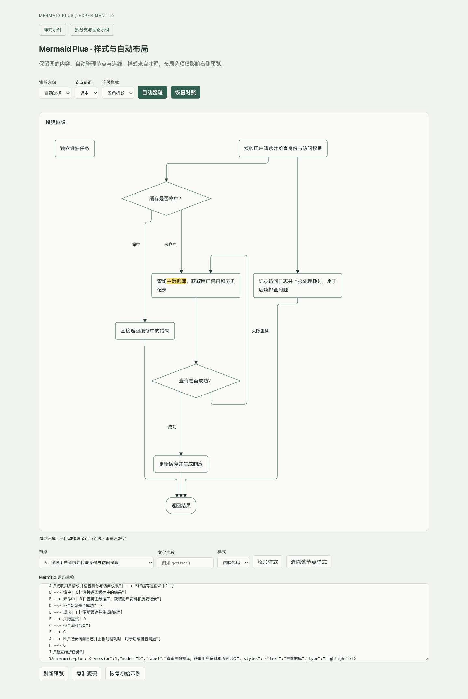

# 自动排版与连线验证

日期：2026-11-12。阶段：从节点定位升级到节点、端口、连线路径和标签联合排版。

## 改动

使用 ELK 的分层布局与直角路由替换旧布局器。长文字先测量和换行，布局器再计算节点尺寸与走线；最后生成圆角或直角矢量路径。节点端口是连线接入或离开节点的位置，各条线有独立端口，菱形端口贴合斜边。

自动方向比较横排与竖排在预览区域中的可读尺寸；也可保留源码方向。密度和线型由界面选项控制，所有选项均只影响预览。

截图来自独立 Chrome，非 Obsidian 应用。

## 验证内容

`npm run check`：20 项单元测试、类型检查及插件构建通过。`npm run test:browser`：9 项真实 Chrome 浏览器测试通过。

- 向上、向下、向左、向右四种方向：节点不重叠，测试图中的直线段不穿过无关节点，连线标签不覆盖节点。
- 自环、回边与重复连线保留；分支起点和汇合终点相互独立；菱形接点位于实际边框。
- 圆角路径保留首尾接点，重复折点不会生成无效坐标。
- 浏览器验证长文字换行、样式恢复、密度/方向/线型切换、展开阅读与源码不变。
- 快速连续操作仅展示最新草稿；临时渲染容器与原生预览组件正常释放。
- 100 节点、200 连线的计算任务启动于 Worker，切换示例能中断旧任务并释放线程。

Claude 的审查发现主线程大图计算会长时间阻塞、中心端口导致箭头重叠；已分别通过独立线程取消/超时与独立接点修正。

## 边界

未修改个人 Obsidian 知识库，尚未做应用内验收。Worker 的启动策略仍需在独立 Obsidian 测试知识库中核验。

图越复杂，排版时间和不可避免的交叉越多；8 秒超时会停止增强布局。标准 Mermaid 参考渲染器仍使用其自身实现。后续已支持子图（`subgraph … end`）；其他复杂语法仍保留原生预览，不做不完整转换。

本阶段没有增加节点拖拽、布局注释保存或笔记自动写回；后续“原位可视化编辑”阶段已实现写回（见 README），拖拽仍未实现。
