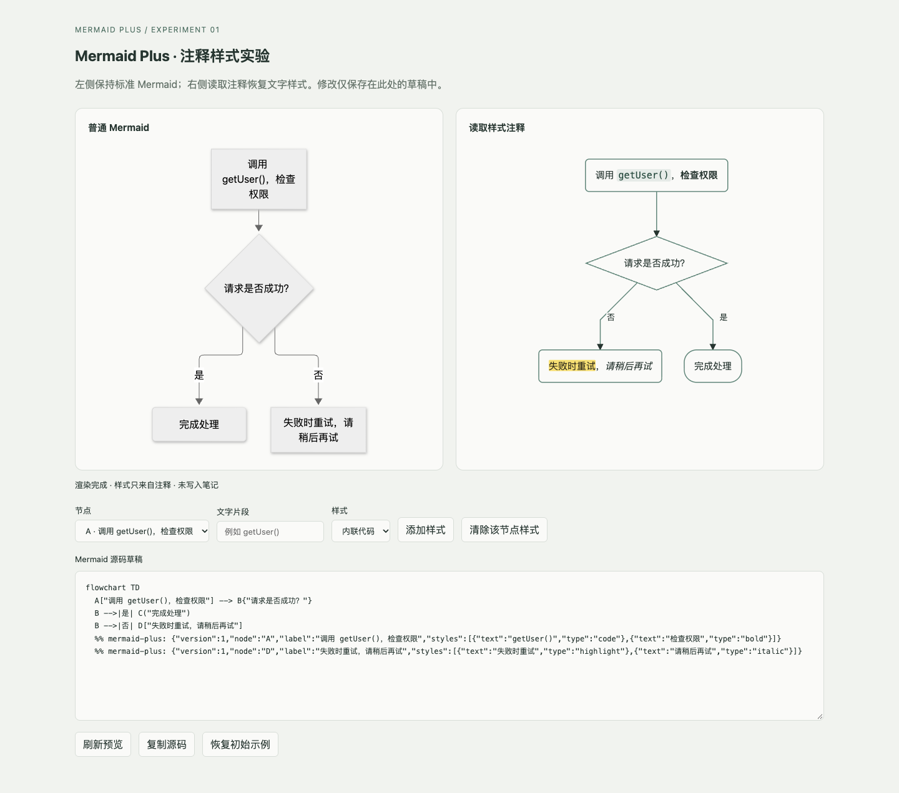

# 注释样式验证记录

日期：2026-11-12。这一阶段要确认的是：能不能把文字样式存在 Mermaid 注释里。

## 结果

同一份 Mermaid 代码，普通渲染器照常显示文字和连线；插件的渲染器能从注释里读出行内代码、粗体、斜体和高亮，可以只给一段文字加样式，也可以叠加。原文改了、要加样式的文字出现多次、或者注释坏了的时候，直接跳过，不去猜该套在哪里。

截图来自一个单独的 Chrome，不是在 Obsidian 里截的。

## 测了什么

| 项目 | 结果 |
| --- | --- |
| `npm run check` | 13 个单元测试通过，类型检查和插件构建通过 |
| `npm run test:browser` | 5 个 Chrome 浏览器测试通过 |
| 看截图 | 四种样式都看得到；菱形上的连线贴着边；节点文字没被截断 |
| 源码保留 | 更新注释时，其他源码、缩进、CRLF 换行和别的节点的注释都不变 |
| 出错时 | 原文改了、文字重复、版本不认识、注释损坏、语法不认识，都有测试 |
| 样式叠加 | 同一段文字可以同时是代码样式和高亮 |
| 缩放 | 容器缩到 65% 后，文字仍按原来大小排版，不会被截断 |

CRLF 是 Windows 常用的换行方式。测试里用作对照的 Mermaid 是 12.3.0；插件里用的是 Obsidian 自带的渲染器，它的版本还要在单独的测试库里确认。

Claude 做了一次只读的代码审查，指出了特殊连线的解析、不认识的注释被覆盖、渲染组件没有释放、缩放后测量不准这几个问题，都已经改好并补了测试。Grok 调研了现有的开源插件；它后来写测试时很久没有产出文件，就停掉了，测试改由主 agent 写。

## 没测到的

- 没有往个人的 Obsidian 库里装插件，也没有读写里面的文件。
- Obsidian 里的命令弹窗只做了类型检查和构建，没有在应用里实际点过。
- 插件这一侧是只支持部分语法的独立渲染原型，排版可能和原生 Mermaid 不一样。
- 那时还没有做在正文里编辑、拖动节点、写回笔记、自动保存、撤销重做和导出图片。（除了导出图片，后来的版本都做了。）
- 额外的样式要靠认得注释的渲染器才能显示，普通查看器只显示图本身。

## 下一步（当时的计划）

先在仓库里的单独测试库里验证 Obsidian 的入口和加载卸载，再做正文里直接编辑。操作方式和注释协议还可以按试用的反馈调整。
