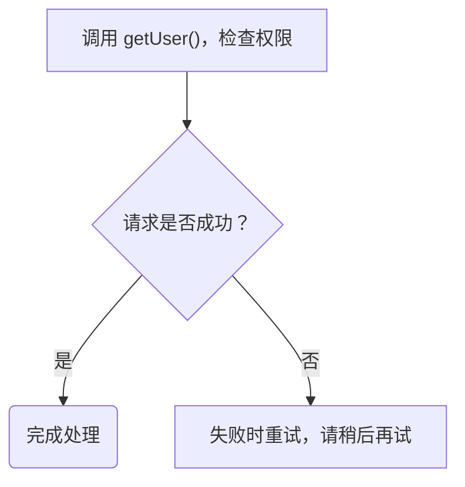

# 注释样式测试文档

用途：仅供 Mermaid Plus 在项目仓库内测试；可以整段复制到实验预览器，不涉及个人知识库。

普通 Mermaid 应显示全部文字和连线；增强预览应显示代码字体、粗体、斜体和高亮。

验证步骤：

1. 选择 A，将“getUser()”再添加为高亮，确认代码与高亮叠加。
2. 将 A 的原始标签文字修改为“调用 getAccount()，检查权限”，刷新，确认旧样式跳过并提示。
3. 在 D 标签内重复“失败时重试”，同步修改注释的 label，刷新，确认重复片段不被猜测定位。
4. 破坏某行样式注释的 JSON，刷新，确认普通图仍可显示、增强侧提示注释无效。
5. 加入 subgraph，确认增强侧明确停止，不重写或删减源码。
